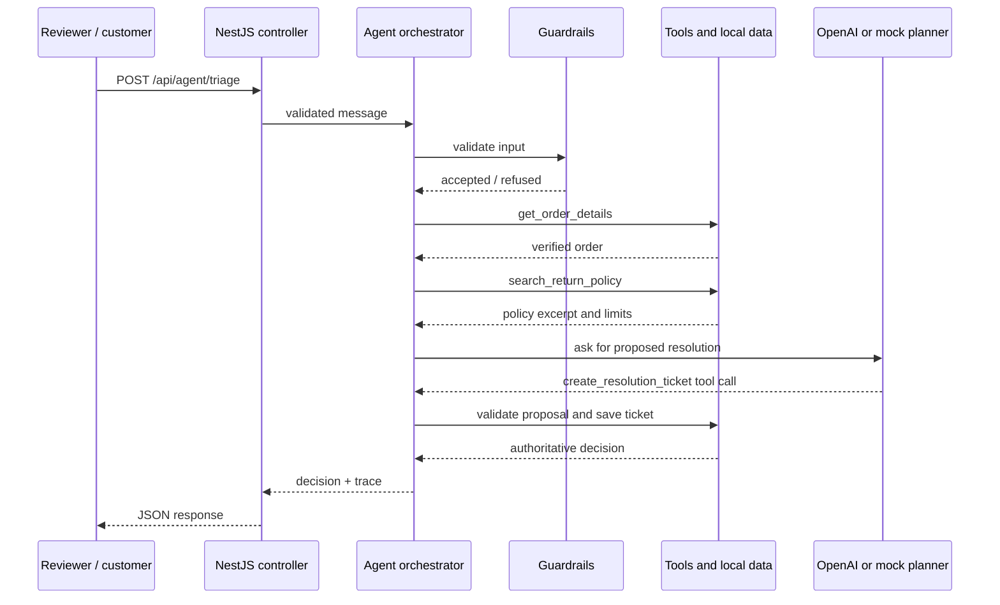

# Як працює оркестратор агента

Цей проєкт використовує власний оркестратор — TypeScript-код, який керує послідовністю кроків, застосуванням бізнес-правил і контрольованим викликом моделі.

## Послідовність одного запиту

1. `POST /api/agent/triage` приймає `TriageRequestDto`; NestJS ValidationPipe перетворює й перевіряє DTO до запуску оркестратора.
2. `GuardrailsService` відсікає короткий, надто довгий, сторонній або схожий на prompt injection запит. Збіг детектора записується як безпечна подія аудиту: request ID, користувач, код детектора та довжина; сирий текст не потрапляє до журналу.
3. Оркестратор знаходить номер замовлення. Якщо його немає, повертає `MISSING_INFORMATION` і не створює тікет.
4. `get_order_details` читає замовлення через Prisma з PostgreSQL або з локального JSON у режимі без БД і додає кількість днів від покупки.
5. `search_return_policy` читає структуровані числові правила з `refund-policy.json`, додає версію політики й знаходить пояснювальний фрагмент у Markdown.
6. У режимі OpenAI модель отримує перевірені дані та просить викликати `create_resolution_ticket`. У режимі mock цю пропозицію формує простий детермінований планувальник без мережевого запиту.
7. `create_resolution_ticket` повторно звіряє дату, категорію та суму з даними сервера. Він може перевизначити пропозицію моделі, після чого ідемпотентно зберігає тікет через Prisma у PostgreSQL; у режимі без БД тікет живе в пам'яті процесу.
8. Оркестратор формує типізоване рішення, чернетку листа і трасу, а Vue показує результат.

## Як читати цей код

- `backend/src/agent/agent.orchestrator.ts` — диригент: визначає порядок кроків і формує відповідь.
- `backend/src/agent/guardrails.service.ts` — рання перевірка, що блокує звернення до інструментів для невалідного запиту.
- `backend/src/tools/tools.service.ts` — інструменти та локальні дані. Тут лежить детермінований захист перед записом тікета.
- `backend/src/auth/oidc-auth.guard.ts` — перевірка підпису, issuer, audience і scope access token у production.
- `backend/src/observability/security-audit.service.ts` — структуроване логування спрацювань prompt injection і запис метаданих у PostgreSQL.
- `backend/src/database/prisma.service.ts`, `backend/src/database/database.service.ts` і `backend/prisma/` — Prisma Client, репозиторій, типізована схема, seed і SQL-міграції PostgreSQL.
- `backend/src/agent/schemas.ts` — контракти даних, які з'єднують API, агента й інтерфейс.
- `backend/src/observability/trace-collector.service.ts` — окрема траса на кожен запит, щоб паралельні запити не змішували кроки.
- `frontend/src/App.vue` — сценарії, рішення, trace та сирий JSON.

## Важлива різниця: tool call і виконання інструмента

Модель не читає файли й не змінює базу напряму. Вона повертає структурований запит на кшталт `create_resolution_ticket` з аргументами. Сервер перевіряє аргументи, викликає власний TypeScript-метод, записує його результат назад у trace і лише тоді формує рішення. Тому аргументи моделі завжди вважаються недовіреними.

Режим mock проходить через ті самі локальні інструменти та перевірки, але пропускає мережевий виклик до OpenAI. Це дає змогу вивчати послідовність і запускати інтеграційний сценарій без ключа або витрат на API.

## Як додати інструмент

1. Опиши аргументи й результат у `schemas.ts` через Zod.
2. Додай метод інструмента в `ToolsService`.
3. Додай його JSON Schema до списку функцій у `agent.orchestrator.ts` та опиши правила використання в `prompts.ts`.
4. Визнач у оркестраторі, на якому етапі інструмент доступний, та перевір права й бізнес-правила на сервері.
5. Додай trace-подію та сценарій, що перевіряє успішний і граничний випадки.

## Безпека та операційні межі

Guardrails є одним із рівнів перевірки, а не повним захистом від усіх атак. Журналізуються лише спрацювання реалізованих евристик; невиявлений prompt injection можливий. API вимагає OIDC у production; PostgreSQL зберігає тікети з ідемпотентністю й actor subject. Джерело замовлень у цій версії лишається JSON-заглушкою, тому перед роботою з реальними клієнтами треба підключити авторитетний order-сервіс і затвердити політику повернення.
